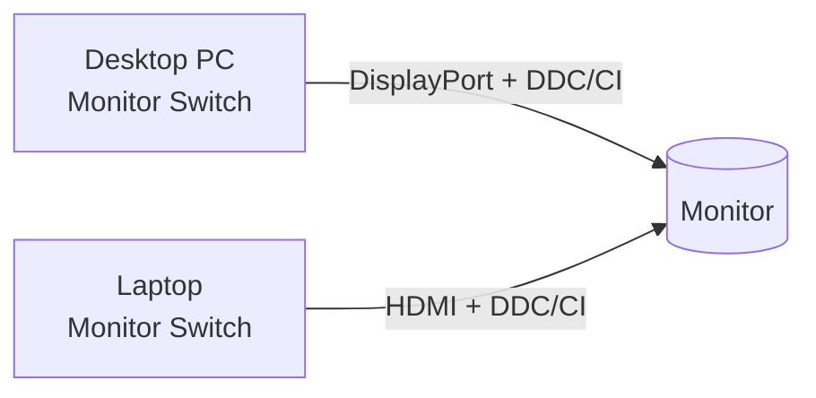

# Monitor Switch


Switch one monitor between two Windows computers with a click, a hotkey or your voice, instead of reaching for the monitor's **Input** button every time.

Monitor Switch is a small tray app for setups like this one: a desktop PC is plugged into one input of a monitor (for example DisplayPort) and a laptop into another (for example HDMI). Run it on both computers. On whichever computer is on screen, click the tray icon or press **Ctrl + Alt + M**, and the monitor switches to the other computer. You can also just say *"switch to laptop"*.

> **🆕 New in 1.1:** voice commands. Say *"switch to laptop"* or *"switch to PC"*, offline and private. See [Voice commands](#voice-commands) and the [changelog](CHANGELOG.md).

## Features

- 🖱️ **One click or one hotkey** (**Ctrl + Alt + M**) switches to the other computer, from either side
- 🎙️ **Voice commands** (optional): *"switch to laptop"* / *"switch to PC"*. They work offline, and nothing is recorded
- 🧠 **Knows which computer it's on** (PC or laptop), so "switch" always goes the right way
- 🎯 **Switch to PC / Switch to Laptop** menu items, to go to a specific computer
- 🔁 **Swap PC / Laptop inputs**: a one-click fix for monitors that number their inputs the other way round
- ⌨️ **Change hotkey...**: press any key combination you like. It warns you if another app already uses it
- 🚀 **Start with Windows**, with no console window and no admin rights
- ℹ️ **Monitor info** shows the computer, the hotkey and voice status, and what the monitor reports
- 💻 **Command line** (`-Toggle`, `-To`, `-Info`) for shortcuts, macro keys or a Stream Deck
- 🔌 **No extra hardware**, no installer, no network access: it talks to the monitor over the video cable
- 📄 **One readable PowerShell file**, so you can see exactly what it does
- 🆓 **Free for personal and non-commercial use** ([see the rules](#rules-for-using-this-project))

---

## Requirements

- **Windows 10 or 11** on both computers. It uses the Windows PowerShell 5.1 that is built into Windows, so there is nothing to install.
- **A monitor with DDC/CI.** Almost every modern monitor has it. Check that it's switched **on** in the monitor's on-screen menu, usually under *System*, *Setup* or *Others*.
- Each computer plugged into a **different input** of the same monitor.

## Quick start

1. [Download the ZIP](https://github.com/JEREMIA-SUNNY/monitor-switch/archive/refs/heads/main.zip) and extract it, or clone the repo:
   `git clone https://github.com/JEREMIA-SUNNY/monitor-switch.git`
2. Copy the folder to **both** computers. Keep `MonitorSwitch.ps1` and `Start Monitor Switch.cmd` together in the same folder.
3. On each computer, double-click **`Start Monitor Switch.cmd`**.
   - The first time, Windows SmartScreen may warn you. Choose **More info → Run anyway**.
4. A small monitor icon appears near the clock. If you don't see it, look under the **^** (hidden icons) and drag it onto the taskbar.
5. Right-click the icon and turn on **Start with Windows**.
6. Test it: right-click the icon and choose **Switch to Laptop**.
   - If the monitor goes to the wrong computer, choose **Swap PC / Laptop inputs**. Do this on both computers. It fixes the menu, the click, the hotkey and voice at the same time.
7. Optional: right-click the icon and turn on **Voice commands**, then say *"switch to laptop"*.

## Using it

| Action | What it does |
|---|---|
| **Left-click the icon** or press **Ctrl + Alt + M** | Switch the monitor to the *other* computer |
| **Switch to PC / Switch to Laptop** | Switch to a specific computer |
| **Swap PC / Laptop inputs** | Fix monitors that use the opposite input numbers (saved) |
| **Change hotkey...** | Press any new key combination (saved) |
| **Voice commands** | Turns voice control on or off (saved). See [Voice commands](#voice-commands) |
| **Monitor info / input codes...** | Shows which computer this is, whether the hotkey and voice are active, and what the monitor reports |
| **Start with Windows** | Starts the app automatically when you sign in |
| **About Monitor Switch...** | Credits and a link to this page |
| **Exit** | Closes the app |

Hover over the icon to see which computer the app thinks it's running on, for example *Monitor Switch (PC)*.

### Voice commands

Right-click the icon and turn on **Voice commands**. Then say:

| Say | What happens |
|---|---|
| *"switch to laptop"* | The monitor shows the laptop |
| *"switch to PC"*, *"switch to computer"* or *"switch to desktop"* | The monitor shows the PC |

- **Offline and private.** It uses the speech recognizer built into Windows (`System.Speech`). Audio stays on your computer: nothing is recorded, saved or sent anywhere. While voice is on, Windows shows its microphone-in-use icon in the taskbar.
- **It only listens for these phrases.** Everything else you say is ignored.
- **Turn it on for every computer that has a microphone.** If both computers hear you, they both send the same command, which is harmless. On purpose, there is no voice command meaning "switch to the other one": if both computers heard it, they would each switch in opposite directions.
- **If only one computer has a microphone**, test whether it can switch the monitor while the *other* computer is on screen. Most monitors accept commands from the input that isn't showing, but some don't.
- **You can change the phrases** in `$VoiceLaptop` and `$VoicePc` at the top of the script. If it triggers by itself (for example from a video), raise `$VoiceConfidence`. If it misses you, lower it.

### Command line

These are useful for a desktop shortcut, a macro key or a Stream Deck button:

```powershell
powershell -ExecutionPolicy Bypass -File MonitorSwitch.ps1 -Toggle   # switch once and exit
powershell -ExecutionPolicy Bypass -File MonitorSwitch.ps1 -To 17    # switch to input code 17 and exit
powershell -ExecutionPolicy Bypass -File MonitorSwitch.ps1 -Info     # show monitors and input codes
```

## Configuration

You can change most things from the tray menu. Those choices are saved per computer in
`%APPDATA%\MonitorSwitch\settings.json`, and they take priority over the defaults at the top of `MonitorSwitch.ps1`:

| Setting | Default | Meaning |
|---|---|---|
| `$PcInput` | `15` | Input code that shows the PC |
| `$LaptopInput` | `17` | Input code that shows the laptop |
| `$ThisMachine` | `'Auto'` | `'Auto'`, `'PC'` or `'Laptop'`. Set this if auto-detection guesses wrong |
| `$PcName`, `$LaptopName` | `PC (DisplayPort)`, `Laptop (HDMI)` | Labels shown in the menu |
| `$HotkeyMods`, `$HotkeyKey` | `Ctrl+Alt`, `M` | Default hotkey |
| `$VoiceLaptop` | `'switch to laptop'` | Phrases that switch to the laptop |
| `$VoicePc` | `'switch to PC'`, `'switch to computer'`, `'switch to desktop'` | Phrases that switch to the PC |
| `$VoiceConfidence` | `0.70` | 0.5 to 0.9. Higher means fewer false triggers |

**Common input codes** (MCCS standard). Many monitors use these, but not all:

| Code | Input |
|---|---|
| 15 | DisplayPort 1 |
| 16 | DisplayPort 2 |
| 17 | HDMI 1 |
| 18 | HDMI 2 |
| 27 | USB-C (on some brands) |

Some monitors swap these numbers or use their own. Use **Swap PC / Laptop inputs**, or try a code with `-To <number>`.

## How it works



1. **DDC/CI.** Besides the picture, a video cable carries a small control channel. Monitors accept commands on it, and this is how brightness apps work. The MCCS standard defines VCP code `0x60` as *input source*. Sending a new value to it changes the input, just like pressing the monitor's Input button.
2. **Windows API.** The script calls Windows' built-in Monitor Configuration API in `dxva2.dll`, using `GetPhysicalMonitorsFromHMONITOR` and `SetVCPFeature`. It does this through a small C# helper that PowerShell compiles in memory with `Add-Type`. No DLL or EXE is shipped.
3. **Which way to switch.** You always press the button on the computer that's on screen, so *switch* simply means *go to the other one*. The app works out whether it's on the PC or the laptop from the Windows chassis type (`Win32_SystemEnclosure`), and checks for a battery as a fallback. You can override this with `$ThisMachine`.
4. **Hotkey.** The hotkey is registered with the Windows `RegisterHotKey` API. Windows gives each combination to only one app. If another app already has it, the menu shows **(OFF)** and you can pick another combination.
5. **Start with Windows.** This adds a per-user entry under `HKCU\Software\Microsoft\Windows\CurrentVersion\Run`. The entry launches the app with `conhost.exe --headless`, so no console window appears.
6. **Voice.** When you turn voice on, the app loads Windows' offline speech engine (`System.Speech.Recognition`) with a small grammar that contains only the phrases above. A recognized phrase is ignored unless its confidence is at least `$VoiceConfidence`. The speech code is compiled only when voice is turned on, so the rest of the app is unaffected if speech isn't available.

**What it touches on your computer:** only `%APPDATA%\MonitorSwitch\settings.json`, plus the `Run` registry value if you turn on *Start with Windows*, plus the microphone while *Voice commands* is on. It makes no network connections, installs no services, and needs no admin rights.

**Limitations**

- It is Windows only for now.
- Built-in laptop screens don't support DDC/CI, so only external monitors are affected. If a computer has **several** external monitors, the command is sent to all of them.
- A few monitors (some LG models, for example) use non-standard input codes. Use `-To` to find yours.

## Troubleshooting

| Problem | Fix |
|---|---|
| Nothing happens when switching | Turn **DDC/CI on** in the monitor's menu. In **Monitor info**, "no reply" means commands aren't reaching the monitor. |
| It goes to the wrong computer (menu, click, hotkey or voice) | Right-click the icon → **Swap PC / Laptop inputs** on both computers. One swap fixes all of them. |
| "No signal" after switching | Your monitor uses other codes. Try `-To 16`, `-To 18`, `-To 27` and so on, then set `$PcInput` / `$LaptopInput`. |
| Menu shows hotkey **(OFF)** | Another app owns that combination. Use **Change hotkey...** |
| Hover text names the wrong computer | Set `$ThisMachine = 'PC'` or `'Laptop'` at the top of the script. |
| Voice: "No microphone found" | Connect or turn on a microphone. Check **Settings → Privacy & security → Microphone → Let desktop apps access your microphone**. |
| Voice: "No Windows speech recognizer is installed" | Add the English speech pack under **Settings → Time & language → Speech** (or **Language & region → English → Language options**). Some newer Windows 11 builds no longer include the classic recognizer. If yours doesn't, the hotkey and the click still work. |
| Voice is on but doesn't react | Speak the exact phrase clearly, or lower `$VoiceConfidence` to `0.6`. **Monitor info** shows whether voice is running. |
| Voice switches by itself | Raise `$VoiceConfidence` to `0.8`, or use longer, more unusual phrases. |
| Double-clicking the `.cmd` does nothing | Run `powershell -ExecutionPolicy Bypass -File .\MonitorSwitch.ps1` in a terminal to see the error. On work laptops, company policy may block scripts. |

## Updating

1. Right-click the icon and choose **Exit**.
2. Replace `MonitorSwitch.ps1` with the new version, on both computers.
3. Double-click **Start Monitor Switch.cmd**.

Your settings (swapped inputs, hotkey, voice, start with Windows) are kept. See [CHANGELOG.md](CHANGELOG.md) for what changed in each version.

## Uninstall

1. Right-click the icon and turn **Start with Windows** off.
2. Choose **Exit**.
3. Delete the folder and `%APPDATA%\MonitorSwitch`.

## Rules for using this project

This project is **free for personal and non-commercial use** under the
[PolyForm Noncommercial License 1.0.0](LICENSE.md). In plain words:

**✅ You can**
- Use it for free on your own computers, for personal use, study, hobby projects and testing
- Change it for your own non-commercial use
- Share it, or your changed version, **for free and non-commercially**, as long as you include the license and the copyright notice
- Use it in charities, schools, public research and government organizations

**❌ You cannot**
- **Use it for any commercial purpose.** That includes selling it, putting it in a paid product, app or service, or using it to make money in any other way.
- **Use it inside a business** for that business's work without written permission from the author
- **Remove the credit or copyright notice** or present it as your own work (see [Credit](#credit))
- **Re-license it** or give anyone else rights under different terms

**⚠️ No warranty.** The software is provided "as is", and the author isn't liable for any problems it causes.

**💼 Want to use it commercially?** Ask first. Open an issue on this repo or contact [@JEREMIA-SUNNY](https://github.com/JEREMIA-SUNNY) to discuss a separate license.

If you break these terms, your license ends, unless you fix the problem within 32 days of being notified (see *Violations* in the license).

This summary is for convenience and is not legal advice. [LICENSE.md](LICENSE.md) is the binding text.

## Credit

Monitor Switch was created by **Jeremia Sunny** ([@JEREMIA-SUNNY](https://github.com/JEREMIA-SUNNY)).

**Required** (by the license's *Notices* section): if you share a copy, fork it, or publish a modified version, you must include:
- [LICENSE.md](LICENSE.md), or its URL
- the two `Required Notice:` lines at the top of `LICENSE.md` and `MonitorSwitch.ps1`, which name the author and link to this repo

**Please also:**
- Keep the in-app credit ("Monitor Switch - by Jeremia Sunny" in the tray menu, and the About box)
- If you write about it, make a video, or build something on top of it, mention **"Monitor Switch by Jeremia Sunny"** with a link to https://github.com/JEREMIA-SUNNY/monitor-switch

## Contributing

Issues and pull requests are welcome. Please keep to these rules:

- **One file, stock Windows.** It must run on the Windows PowerShell 5.1 that ships with Windows, with no modules and no installs.
- **C# 5 only** inside the `Add-Type` block, because Windows PowerShell compiles with the older C# compiler. That means no `$"..."` strings and no `?.`.
- **Test on a real monitor** before opening a PR, and mention the monitor model. Reports of monitors with non-standard input codes are especially helpful.
- **Keep it private and offline.** No telemetry and no network calls.
- By contributing, you agree that your contribution is released under this project's license, and that Jeremia Sunny may also offer it under other terms, including commercial licenses.

## License

Copyright © 2026 Jeremia Sunny. Released under the [PolyForm Noncommercial License 1.0.0](LICENSE.md). It is free for non-commercial use, and commercial use needs permission.
